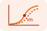

# MeiYu "Cindy" Kuo

**Design Verification · RTL Design · DFT · Physical Design**

I build small chips end to end and don't trust one check: every chip design here is verified by simulation, a reference model **and** formal proof, then taken to a signed-off layout.
M.S. Semiconductor Engineering, Northeastern University (May 2028) · Bay Area, CA.

  

**Keywords:** `Verilog` `SystemVerilog` `UVM` `SVA` `cocotb` `Formal (SymbiYosys)` `Conformal LEC` `CDC` `Scan / ATPG` `MBIST` `Genus` `Innovus` `OpenROAD` `STA` `Virtuoso` `Python` `TCL` `CI/CD`

---

### Featured projects

<table>
<tr>
<td width="50%" valign="top">
 
<b><a href="https://github.com/ymt1001816-cyber/cache-rtl-to-signoff">1 KB Cache: RTL to Signoff</a></b> 
45 nm cache taken from Verilog to a DRC-clean, LVS-correct layout, then made testable and low-power.

<b>UVM 100% functional coverage · 4/4 planted bugs caught · LEC proves RTL = netlist = layout · clock gating cuts power 86% while scan coverage stays at 99.84%</b>

<code>UVM</code> <code>cocotb</code> <code>formal</code> <code>Innovus</code> <code>OpenROAD</code> <code>scan/ATPG</code> <code>MBIST</code>
</td>
<td width="50%" valign="top">
 
<b><a href="https://github.com/ymt1001816-cyber/async-fifo-cdc">Async FIFO: the CDC bug simulation can't see</a></b> 
Dual-clock FIFO checked with cocotb and with formal using a metastability model.

<b>Binary-pointer bug passes every simulation, formal catches it in 11 steps · Gray-code version proven for any clock ratio</b>

<code>CDC</code> <code>SymbiYosys</code> <code>k-induction</code> <code>cocotb</code>
</td>
</tr>
<tr>
<td width="50%" valign="top">
 
<b><a href="https://github.com/ymt1001816-cyber/sram-bisr">SRAM Built-In Self-Repair</a></b> 
Programmable March MBIST finds bad cells, redundancy analysis picks spares, the address path remaps them.

<b>2 spare rows + 2 spare columns repair 99.8% of line faults vs 66% with rows only · fault injection shows what March C- misses</b>

<code>MBIST</code> <code>BIRA</code> <code>DFT</code> <code>formal equivalence</code>
</td>
<td width="50%" valign="top">
 
<b><a href="https://github.com/ymt1001816-cyber/ivchar">ivchar: MOSFET I-V characterization</a></b> 
Python tool that drives a B1500A or SCPI SMU, extracts Vth / SS / DIBL and writes a yield report.

<b>Tracks BSIM corner Vth shifts within 3 mV · 83 tests in CI · example data is simulated</b>

<code>Python</code> <code>PyVISA</code> <code>pandas</code> <code>device physics</code>
</td>
</tr>
</table>

---

### Why these projects
- **Bugs that one method misses.** Each repo shows a bug that slipped past the first check and what caught it: signoff, formal, or a reference model.
- **Reproducible.** Every repo runs its full regression in GitHub Actions on every push; the open-source layout flow runs there too.
- **Design for test, not after.** Low-power and DFT were built together, so clock gating didn't cost scan coverage.

Looking for Summer 2027 internships in design verification, RTL design or DFT. Happy to walk through any of these projects.
